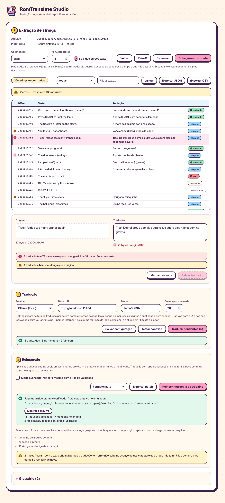

<p align="center">
  
</p>

<h1 align="center">RomTranslate Studio</h1>

<p align="center">
  <b>Traduza jogos retrô com IA, no seu computador.</b><br>
  Arraste o arquivo do jogo, revise a tradução, exporte um patch. A sua ROM não sai da sua máquina.
</p>

<p align="center">
  <a href="https://github.com/crimsondawnacademy-design/romtranslate-studio/releases"></a>
  <a href="https://github.com/crimsondawnacademy-design/romtranslate-studio/actions/workflows/ci.yml"></a>
  <a href="LICENSE"></a>
  <a href="https://github.com/crimsondawnacademy-design/romtranslate-studio/stargazers"></a>
</p>

<p align="center">
  <a href="https://romtranslate-studio.pages.dev/"><b>Experimente no navegador</b></a> ·
  <a href="README.md">Read in English</a>
</p>



<p align="center"><i>Projeto de demonstração com dados inventados. Nenhum conteúdo de jogo real fica neste repositório. <a href="docs/assets/screenshot-full.png">Veja a tela inteira.</a></i></p>

## O que ele faz

1. **Detecta** a plataforma do arquivo que você arrasta (11 formatos, mostrando a evidência que usou).
2. **Extrai** o texto e descarta os bytes que só parecem texto.
3. **Traduz** com a IA que você escolher, vários lotes ao mesmo tempo, dizendo ao modelo quanto espaço cada fala tem.
4. **Valida** cada fala: marcadores, códigos de controle, caracteres que o jogo escreve e tamanho. O que não cabe volta sozinho para a IA.
5. **Reinsere** numa cópia de trabalho e confere. O arquivo original nunca é modificado.
6. **Exporta um patch** (IPS ou BPS), que você compartilha no lugar do jogo.

Se gostou da ideia, uma estrela ajuda outras pessoas a acharem o projeto.

## Funciona mesmo?

É software alpha, e isto é o que foi medido até agora, num jogo comercial de Game Boy Advance do cartucho do próprio mantenedor (só números; nenhum dado do jogo está neste repositório):

| Medida | Resultado |
|---|---|
| Trechos de texto traduzidos e regravados | 10.705 |
| Mensagens com os códigos de controle idênticos byte a byte | 3.699 de 3.699 |
| Bytes alterados fora de texto de mensagem | 0 |
| O jogo liga com a tradução; abertura e primeiro diálogo conferidos num emulador | sim |
| Falas da IA que passam na validação, ChatGPT pelo Codex CLI, com repergunta automática | 199 de 200 |
| Velocidade com 4 lotes em paralelo | 200 falas em 86 s |

O que isso **não** prova: ninguém jogou esse jogo até o fim com a tradução, só um jogo real passou pelo processo inteiro, e a versão com acento precisou de tabela de caracteres e de região do texto indicadas à mão. Veja [o que ainda não faz](#o-que-ainda-não-faz).

## Baixar

Pegue o instalador do seu sistema na [versão mais recente](https://github.com/crimsondawnacademy-design/romtranslate-studio/releases):

| Sistema | Arquivo |
|---|---|
| macOS (Apple Silicon ou Intel) | `.dmg` |
| Windows | `-setup.exe` ou `.msi` |
| Linux | `.deb`, `.rpm` ou `.AppImage` |

Os binários não são assinados (é projeto pessoal e certificado é pago), então o sistema reclama na primeira vez:

- **macOS** diz que o app está danificado. Depois de arrastar para Aplicativos, rode `xattr -cr "/Applications/RomTranslate Studio.app"`.
- **Windows** SmartScreen: "Mais informações" e depois "Executar assim mesmo".
- **Linux**: `chmod +x RomTranslate*.AppImage`.

Só o instalador de macOS foi aberto e usado por uma pessoa até agora. Os de Windows e Linux são compilados pelo CI e ainda precisam de alguém que teste: se você testar, [abra uma issue](https://github.com/crimsondawnacademy-design/romtranslate-studio/issues) contando o que aconteceu.

## Escolha a sua IA

| Provedor | Custo | Observações |
|---|---|---|
| **Ollama** | grátis, roda no seu computador | Nada sai da sua máquina. Modelo pequeno tem dificuldade de manter a fala curta. |
| **Assinatura do ChatGPT** pelo Codex CLI | o plano que você já tem, sem chave de API | O login é feito de dentro do app. Vale o limite de uso do seu plano. |
| **Claude** (API da Anthropic) | a sua chave de API | O app calcula o gasto antes da rodada e mostra o que foi cobrado depois. |
| Qualquer endpoint **compatível com a API da OpenAI** | a sua chave | OpenRouter, LM Studio, gateway da empresa. |

Tudo o que não é local pede a sua permissão explícita: o app diz qual texto vai sair, e só as falas extraídas saem, nunca o arquivo do jogo.

## Consoles

Toda plataforma real é **experimental**. Jogos usam motores, compressões e tabelas de caracteres diferentes, então não há promessa de suporte universal.

| Plataforma | Extrai | Reinsere | Tradução maior que o original |
|---|---|---|---|
| Game Boy Advance | sim | no lugar, checksum do header recalculado | sim, para texto apontado por tabela de ponteiros |
| Nintendo DS | sim, ASCII e UTF-16 por arquivo | no lugar, CRC do header recalculado | sim, o arquivo cresce e a FAT é reapontada |
| NES | sim, ASCII ou tabela `.tbl` | no lugar | não |
| Super Nintendo | sim | no lugar, checksum interno recalculado | não |
| GameCube | sim, por arquivo | no lugar | não |
| PlayStation 1 (ISO, BIN raw, `.cue`) | sim, por arquivo | no lugar, EDC/ECC do setor regenerado | pouco, na sobra do último setor |
| PlayStation 2 (inclui DVD acima de 2 GiB) | sim, por arquivo | no lugar | não |
| PSP | sim, por arquivo | no lugar | não |
| Game Boy / Color, Mega Drive / Genesis (com Pico e 32X), Master System / Game Gear, WonderSwan / Color, Nintendo 64 (`.z64`) | sim, ASCII e Shift-JIS (novo, conferido só com arquivos de teste) | no lugar, com o checksum do cartucho refeito quando o do original estava certo | não |
| PC Engine (HuCard), cartucho de MSX, Famicom Disk System, Neo Geo Pocket | sim, ASCII e Shift-JIS (novo, conferido só com arquivos de teste) | no lugar | não |
| Saturn, Mega-CD (ISO, BIN raw) | sim, por arquivo, ASCII e Shift-JIS (novo, conferido só com arquivos de teste) | no lugar, EDC/ECC do setor regenerado | não |
| Wii, Wii U | só detecção | não | não |

"No lugar" quer dizer que a tradução ocupa o espaço da fala original. A matriz completa, com o que cada coluna significa e os limites conhecidos, está em [docs/DETALHES.md](docs/DETALHES.md). Quais plataformas as listas de pedidos de tradução pedem, e o que ainda falta, está em [docs/PLATAFORMAS.md](docs/PLATAFORMAS.md).

## O que ainda não faz

- Texto comprimido: no Game Boy Advance o app extrai e regrava o texto de dentro dos blocos LZ77, e a tradução precisa caber no espaço da original dentro do bloco. Isso foi conferido só com arquivo de teste: nenhum jogo real com texto comprimido passou por aqui. No DS o texto comprimido é só contado, e outros compressores não são reconhecidos.
- Japonês: o app lê texto em Shift-JIS (a forma mais comum nos jogos de disco) e, no Game Boy Advance, texto em códigos de 16 bits na ordem da tabela japonesa padrão, montando a tabela de letras sozinho (isso sai na próxima versão). Um jogo japonês real foi medido: o app lê 12.296 mensagens dele, 96,6% do japonês do cartucho (os poucos kanji saem trocados, porque o jogo tem uma lista própria). Gravar a tradução de volta ainda é o gargalo: cada letra ocupa o espaço de um caractere japonês, a frase não muda de lugar e a tradução sai sem acento, então do japonês para o português quase nunca cabe. Ninguém viu uma tradução dessas rodando. Palavra escrita só em kanji não é lida em Shift-JIS, e jogo de cartucho com tabela própria fora da ordem padrão continua pedindo a tabela.
- Não edita fonte nem texto desenhado como imagem (tela de título, alguns menus).
- A maior parte do texto só pode ter o tamanho do original. Crescer depende de uma tabela de ponteiros que o app reconheça; tabela indicada pelo usuário está no roteiro.
- Escolher a região do texto e a tabela de caracteres de um jogo de cartucho ainda é trabalho manual.

## Traduzir com uma IA o jogo que o app não lê

Quando a extração automática não acha a fala de um jogo, uma IA de programação estuda o arquivo por você: acha a tabela de letras, onde cada frase começa e termina, os ponteiros e as letras acentuadas da fonte, e anota tudo num perfil pequeno do jogo (`perfil.toml`, ver [docs/PERFIL.md](docs/PERFIL.md)). O app traduz, valida, regrava e exporta o patch. O passo a passo está em [skills/traduzir-rom/SKILL.md](skills/traduzir-rom/SKILL.md), com ferramentas pequenas em Python ao lado. O Claude Code acha a skill sozinho quando aberto nesta pasta; o Codex e outras IAs chegam a ela pelo [AGENTS.md](AGENTS.md). Não precisa ser romhacker, mas precisa ter o arquivo do jogo: compartilhe só o patch e o perfil.

## Para quem gosta de fuçar

- A **busca relativa** descobre a tabela de caracteres do jogo a partir de uma palavra que você sabe que aparece nele, e grava o `.tbl`.
- O **Raio-X** mostra o que o app não lê: blocos comprimidos, áreas densas, quantas falas podem crescer.
- **Linha de comando**: cada passo também roda sem a janela, a partir do código: `cargo run -p romtranslate-cli -- --help`. Os comandos estão em [docs/DETALHES.md](docs/DETALHES.md#sem-a-janela-cli).
- **Escreva um adapter** para uma plataforma ou motor novo: [docs/ADAPTERS.md](docs/ADAPTERS.md).

## Compilar do código

Você precisa de Rust estável, Node 20 ou mais novo, pnpm e das [dependências de sistema do Tauri 2](https://tauri.app/start/prerequisites/).

```bash
git clone https://github.com/crimsondawnacademy-design/romtranslate-studio.git
cd romtranslate-studio
pnpm install
pnpm dev
```

Para testar sem jogo, `cargo run -p romtranslate-core --example gen_fixtures` grava arquivos sintéticos em `fixtures/generated/`.

## Regras da casa

- **Patch primeiro.** Compartilhe o patch, nunca o jogo. O app trabalha com arquivos que você já tem e não baixa ROM.
- **Local primeiro.** O arquivo do jogo fica no seu computador.
- **Nenhuma ROM comercial, BIOS ou chave** neste repositório, nos testes ou nas issues. As fixtures são sintéticas.
- **Nada declarado sem teste.** Uma capacidade só entra na lista quando um teste de ida e volta prova.

## Contribuir

Erro, jogo que não funcionou, plataforma que você quer: as [issues](https://github.com/crimsondawnacademy-design/romtranslate-studio/issues) estão abertas, e o [CONTRIBUTING.md](CONTRIBUTING.md) explica como mandar código. Nunca anexe ROM comercial.

## Apoie o projeto

O RomTranslate Studio é gratuito, tem licença MIT e é feito no tempo livre. Se ele te ajudou:

- **Dê uma estrela no repositório.** Não custa nada e é o que faz o projeto aparecer.
- **Pix:** chave `13982286871` (telefone).

## Licença

[MIT](LICENSE). A licença cobre só este software: não dá direito sobre nenhum jogo, marca ou tradução de obra de terceiros.
